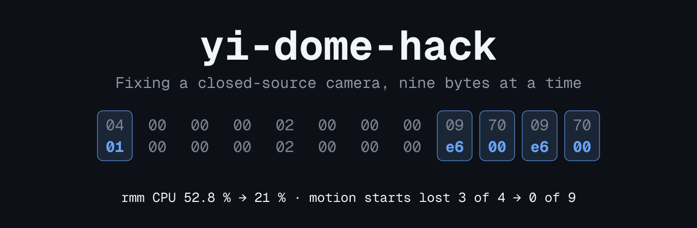
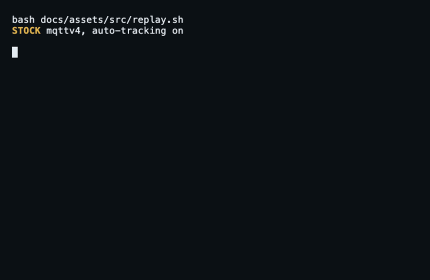
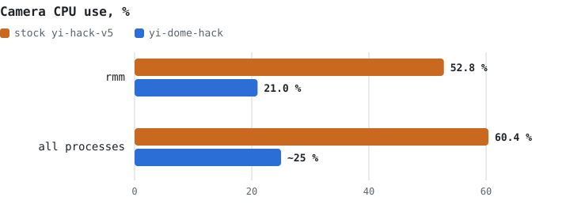
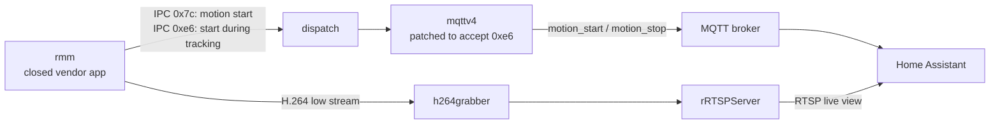

<p align="center">
  
</p>

<p align="center">
  <b>Reverse engineering a Yi Dome 720p so Home Assistant stops missing motion.</b><br>
  Nine bytes patched across two binaries, a trimmed boot, and every claim measured on the real device.
</p>

<p align="center">
  
  
  
  
  
</p>

<p align="center">
  <a href="#-the-bug">The bug</a> ·
  <a href="#-results">Results</a> ·
  <a href="#-how-it-works">How it works</a> ·
  <a href="#-safety">Safety</a> ·
  <a href="#-status">Status</a> ·
  <a href="#-try-it">Try it</a>
</p>

---

## 🐛 The bug

The Yi Dome is a pan-and-tilt camera that follows movement. With auto-tracking on, Home Assistant saw motion **stop** but often never saw it **start**.

The closed `rmm` app reports a motion start that happens during a tracking cycle as IPC id `0x00e6`. The open MQTT bridge, `mqttv4`, only listened for `0x007c`. Five changed bytes in one IPC match constant fix it:

<p align="center">
  
</p>

<sub>Rows replayed from the [stock](docs/measurements/2026-10-21-tsk002-stock-baseline.md) and [patched](docs/measurements/2026-10-21-tsk009-no-audio-thread-boot.md) measurement notes, with time compressed. Patched rows are an excerpt.</sub>

The second surprise: the microphone pipeline ate about 30 points of CPU while nothing used it. Replacing a single `bl pthread_create` with `mov r0, #0` stops that thread from ever starting.

## 📊 Results

<p align="center">
  <picture>
    <source media="(prefers-color-scheme: dark)" srcset="docs/assets/cpu-chart-dark.svg">
    
  </picture>
</p>

| Metric | Stock yi-hack-v5 | yi-dome-hack | |
|---|---:|---:|---|
| `rmm` CPU | 52.8 % | **21.0 %** | 🟢 −31.8 points |
| All processes | 60.4 % | **~25 %** | 🟢 |
| Free RAM (mean) | ~800 kB | **~1 700 kB** | 🟢 about double |
| 1-min load (mean) | 5.91 | **4.76** | 🟢 −19 % |
| Motion starts lost, tracking on | 3 of 4 | **0 of 9** | 🟢 short runs, see [Status](#-status) |
| Still image, median | 1.60 s | **1.05 s** | 🟢 |

CPU, RAM and load: 3 × 300 s windows, no stream client, compared in the [no-audio-thread note](docs/measurements/2026-10-21-tsk009-no-audio-thread-boot.md). A [re-check after 12 days of uptime](docs/measurements/2026-11-04-recheck-cpu.md) read `rmm` 22.0 %, all processes 26.8 %, load 4.76. Stills: [20 requests](docs/measurements/2026-10-22-tsk005-snapshot-split.md).

> [!IMPORTANT]
> The CPU win has a price: **no SD clips and no two-way talk** ([ADR-0008](docs/adr/0008-live-view-only.md)). This build is for live view plus motion events.

## 🔧 How it works



| Patch record | Binary | Offset | Bytes | Effect | In use |
|---|---|---|---:|---|---|
| [`mqttv4-0.4.1-motion-start-e6`](patches/mqttv4-0.4.1-motion-start-e6.json) | `mqttv4` | `0x5928` | 5 | Counts `0xe6` as a motion start | ✅ |
| [`rmm-1.9.1.0J-no-audio-thread`](patches/rmm-1.9.1.0J-no-audio-thread.json) | `rmm` | `0x24218` | 4 | Never starts the audio capture thread | ✅ |
| [`rmm-1.9.1.0J-skip-speex-preprocess`](patches/rmm-1.9.1.0J-skip-speex-preprocess.json) | `rmm` | `0x2ee64` | 4 | Skips speex only, saves 7.3 points, keeps recording | ❌ measured, not used |

The boot script is cut down to an allow-list of services ([ADR-0004](docs/adr/0004-allow-list-boot.md)): cloud, ONVIF, FTP, telnet and SD recording are gone.

<details>
<summary><b>🔬 Dig into the reverse engineering</b></summary>

- [`docs/research/rmm.md`](docs/research/rmm.md): threads, IPC ids and patch offsets in `rmm`
- [`docs/research/mp4record.md`](docs/research/mp4record.md): why SD recording stalls without audio
- [`docs/evaluation.md`](docs/evaluation.md): feasibility, riskiest assumption and kill criteria
- [`docs/overview.md`](docs/overview.md): scope and success metrics
- [`docs/adr/`](docs/adr/): every founding decision, one file each
- [`docs/measurements/`](docs/measurements/): results and raw data

Task and report IDs (`TSK-`, `RPT-`, `LRN-`) in the docs refer to a private backlog that is not published.

</details>

## 🔐 Safety

The camera has no recovery path you control, so the project is built around not needing one.

- 💾 **SD card only.** Nothing writes the NOR flash ([ADR-0001](docs/adr/0001-sd-only-overlay-install.md)). A failed or removed card falls back to the stock Yi apps through the existing boot hook.
- 🔒 **Verified patches.** Every record pins the file, offset, original bytes, replacement bytes and both sha256 hashes ([ADR-0002](docs/adr/0002-verified-in-place-binary-patches.md)). The wrong input writes nothing:

<p align="center">
  
</p>

- ↩️ **Backups first.** Deploy scripts copy each replaced file to a folder on the SD card and print a rollback line.
- 📏 **Measure, then claim.** One change at a time, with before and after numbers from the camera ([ADR-0005](docs/adr/0005-on-device-measurement-gate.md)).
- 🔑 **Credentials stay out.** They live in `.env`, never in the repo, and never in the command line of a new process ([ADR-0006](docs/adr/0006-secrets-out-of-argv-and-repo.md)).

## 🚧 Status

Early results are good, but the targets are not all met.

| Target | Today | |
|---|---|---|
| 0 lost motion starts over 7 days, tracking on | 0 of 9 in 58 min | 🟡 7-day run not done |
| Motion at the broker in under 1 s | Stops: 0.010 s median. `0x7c` start: 0.007 s | 🟡 `0xe6` latency not measurable yet |
| Still image: median under 2 s, max under 4 s | 1.05 s, 1.63 s | ✅ met |
| Boot to MQTT in under 30 s | About 47 s | ❌ not met |
| 1-min load at least 20 % below stock | −19 % | 🟡 just short |

## 🚀 Try it

> [!WARNING]
> This is a personal project for **one** hardware and firmware combination. There is no installer and no release. Use it at your own risk, on a camera you own, and read the ADRs first.

**You need:**

- 📷 Yi Dome **720p** (Hi3518EV200, OV9732) on base firmware `1.9.1.0J_201809191135`
- 💿 [yi-hack-v5](https://github.com/alienatedsec/yi-hack-v5) 0.4.1 already installed
- 🧩 `rmm` and `mqttv4` from your own install. No vendor firmware or vendor binaries are in this repo, and the hash checks reject anything else

**1. Motion fix.** This one stands alone. Take both hashes from the patch record:

```bash
cp .env.example .env   # fill in camera access, kept local
python3 scripts/patch-apply.py patches/mqttv4-0.4.1-motion-start-e6.json mqttv4 mqttv4-patched
scripts/cam-deploy-file.sh mqttv4-patched /tmp/sd/yi-hack-v5/bin/mqttv4 <input-sha256> <output-sha256> --yes
scripts/cam-ssh.sh 'killall mqttv4; sleep 1; . /tmp/sd/yi-hack-v5/script/env.sh; cd /; nohup /tmp/sd/yi-hack-v5/bin/mqttv4 >/dev/null 2>&1 &'
```

The deploy script refuses to run if `YI_RTSP_PASSWORD` is unset or equals `YI_PASSWORD`.

**2. CPU patch.** Build `rmm` with [`rmm-1.9.1.0J-no-audio-thread`](patches/rmm-1.9.1.0J-no-audio-thread.json) and copy it to `/tmp/sd/yi-dome-hack/rmm-no-audio/rmm`. Then copy `overlay/yi-hack-v5/script/` to the SD card and run `busybox reboot`. This removes SD clips and two-way talk.

> [!CAUTION]
> Put the patched `rmm` in place **before** copying the overlay. The overlay's `system.sh` starts `rmm` only from that path, so a missing file means no video.

## 📁 Repository layout

```text
patches/    binary patch records, applied by scripts/patch-apply.py
overlay/    modified yi-hack-v5 boot scripts for the SD card
scripts/    patch, deploy, SSH and measurement helpers
build/      ARMv5 static cross-build in a container
docs/       ADRs, research notes and raw measurements
```

## 🙏 Credits and license

All credit for the base project goes to the authors of [alienatedsec/yi-hack-v5](https://github.com/alienatedsec/yi-hack-v5) and [roleoroleo/mqttv4](https://github.com/roleoroleo/mqttv4).

Licensed under [GPL-3.0](LICENSE). The scripts in `overlay/` are modified copies of yi-hack-v5 files.
